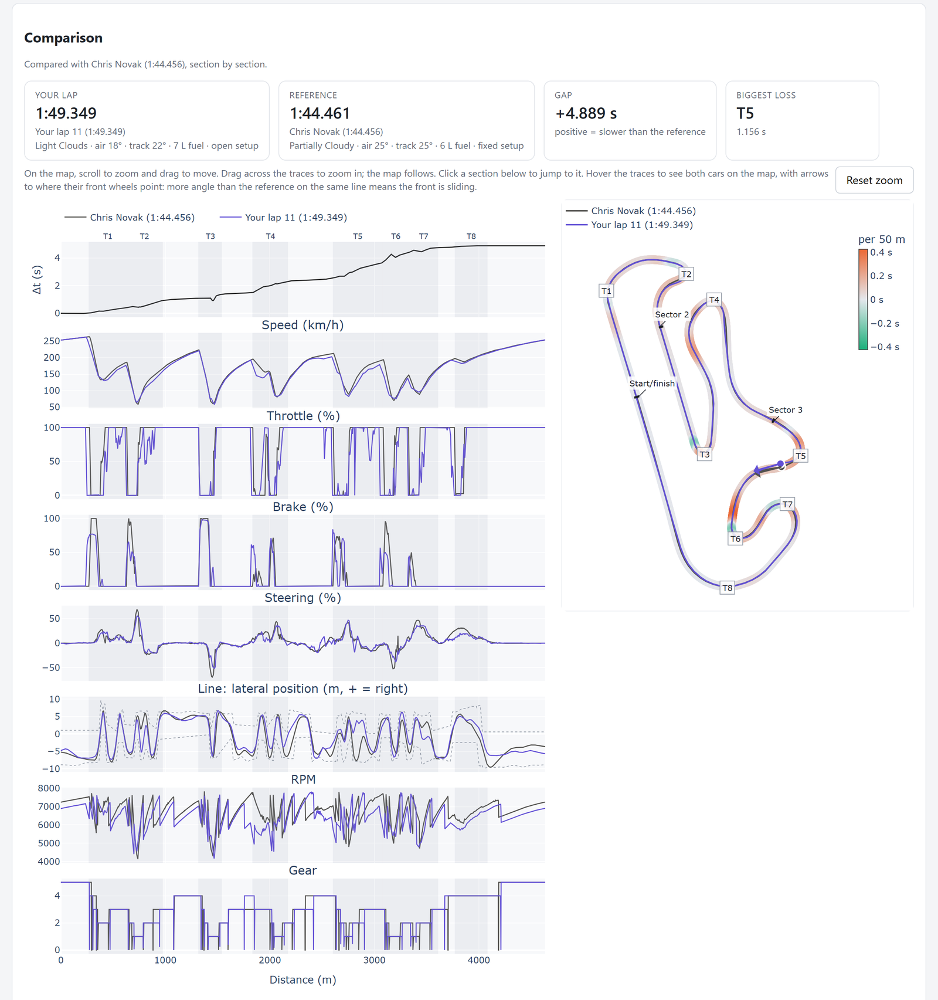
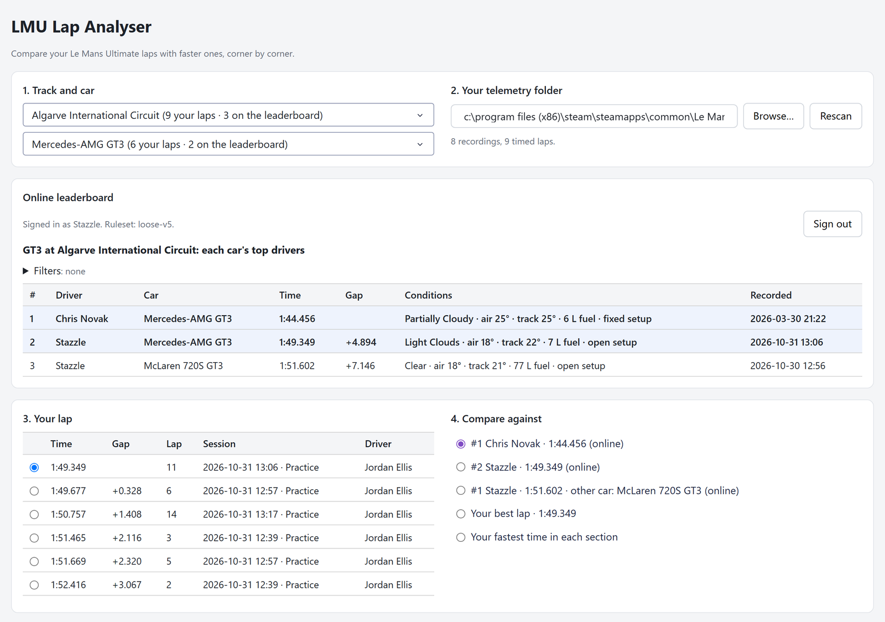
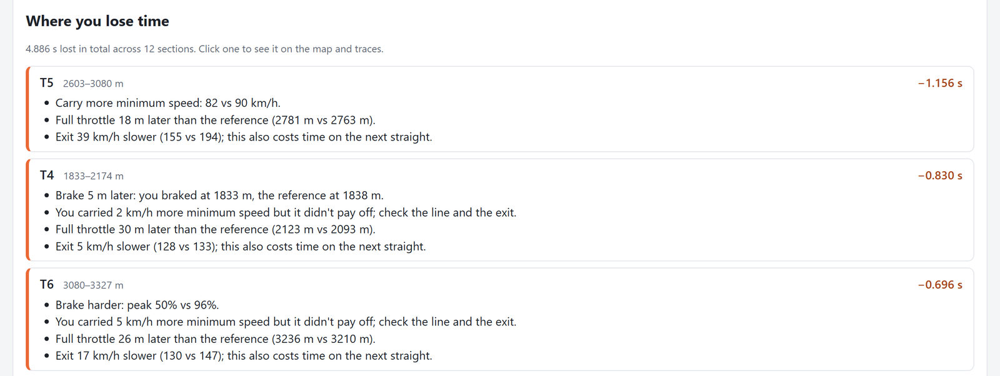

# LMU Telemetry

Compare your Le Mans Ultimate laps against fast reference laps, and see
corner by corner (and straight by straight) where you lose time and why.

**LMU Lap Analyser** is a local app: pick a track and car, choose one of your
laps and a lap to compare against (from the online leaderboard, or your own),
and it shows where you lose time and why, with traces and a track map.
Status: early, but usable.



## Getting started (Windows)

1. In LMU, turn on telemetry recording (Settings → Gameplay) and drive a
   session with a few timed laps.
2. Start the app, either way:
   - **The exe:** download [`lmu-analyser.exe`](https://github.com/bgenerowicz/lmu_telemetry/releases/latest/download/lmu-analyser.exe)
     from the [latest release](https://github.com/bgenerowicz/lmu_telemetry/releases/latest)
     and run it. It is built from this repository on every change, but it
     isn't signed, so Windows warns about an unknown publisher: choose
     "More info" → "Run anyway".
   - **From source**, if you'd rather not run an unsigned exe: see
     [Running from source](#running-from-source).

   The app opens in your browser. Keep its console window (or terminal) open;
   closing it quits the app.

## Using it

1. **Track and car**: from your recordings and the online leaderboard.
2. **Telemetry folder**: found through Steam if possible; otherwise
   **Browse…** to LMU's `UserData\Telemetry`. It's remembered.
3. **Your lap**: your timed laps for that track and car, fastest first.
4. **Compare against**: a lap from the online leaderboard, your own best lap,
   or your fastest time through each section (a theoretical best lap).
   **Also show** puts up to two more laps on the traces and map, e.g. the
   top 3 on the leaderboard.



The comparison shows traces (time gap, speed, pedals, steering, line, RPM, gear)
next to a track map with both driving lines and the track edges. Hover the
traces to see both cars on the map; drag across the traces, or click one of
the "where you lose time" sections, to zoom the map to that stretch. Scroll on
the map to zoom, drag to move.

Below that, **Where you lose time** ranks the corners and straights by time
lost, with what to change in each:



**Setup** lists the settings where the other laps' car setups differ from
yours (wing, tyre pressures, springs, brake balance and so on), with every
setting folded away below.

### Online leaderboard

Anyone can see it. It has one leaderboard per class (e.g. GT3) at each track,
with each car's top 5 drivers and the conditions each lap was driven in.
Click a lap to compare against it, and use **Filters** to narrow it down by
car, fixed or open setup, track temperature and fuel load.

To add your own laps, **Sign in with Steam**. The app lists your laps that
would make the leaderboard; tick the ones you want and click **Upload
selected laps**. The server checks each lap before adding it: a complete,
timed lap that stays on track, in the dry. The leaderboard shows your Steam
name, and others can see each lap's telemetry and car setup; see the server's
privacy page for what it stores.

## Running from source

This runs the code in this repository as it is, with nothing prebuilt.

1. Install [Python](https://www.python.org/downloads/) 3.11 or newer (on
   Windows, tick "Add python.exe to PATH" in the installer).
2. Get the code: **Code → Download ZIP** on GitHub and unzip it, or
   `git clone https://github.com/bgenerowicz/lmu_telemetry.git`.
3. Open a terminal in that folder (in Explorer: right-click the folder →
   "Open in Terminal") and install the app into its own environment, once:

   ```powershell
   python -m venv .venv
   ```

   ```powershell
   .venv\Scripts\pip install -e ".[webapp]"
   ```

4. Start it (this is also how you start it next time):

   ```powershell
   .venv\Scripts\python -m desktop
   ```

To update, download the code again (or `git pull`) and repeat step 3.

On Linux or macOS (for recordings copied from a Windows PC), use
`.venv/bin/pip` and `.venv/bin/python` instead.

## Contributing

Issues and pull requests are welcome; see [CONTRIBUTING.md](CONTRIBUTING.md)
for how the code fits together and how to run the tests.

## License

[MIT](LICENSE). Not affiliated with Le Mans Ultimate or its developers.
